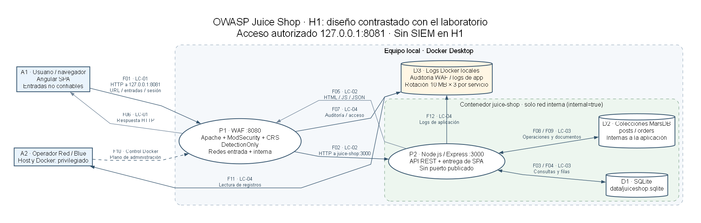
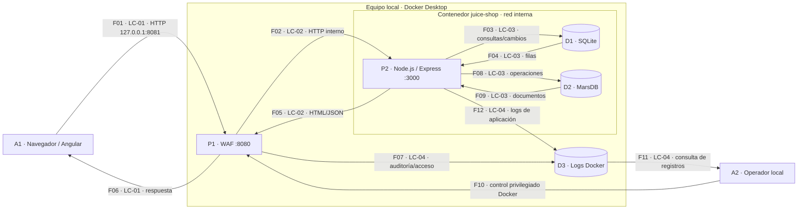

# PASTA III — Descomposición y DFD

Modelo contrastado con Compose, estado de contenedores, HTTP, auditoría y código de la imagen 20.4.0-SNAPSHOT. [Evidencia y alcance de verificación](evidencias/VERIFICACION.md). Las flechas modelan intercambio de información; no todas fueron capturadas paquete por paquete.

La migración a `Gegdgt/juice-shop` no cambia los procesos ni los flujos del
laboratorio. Compose sigue usando la imagen fijada, sin construir desde el fork.
Se contrastaron nueve archivos de esa imagen con el commit base del fork;
[resultado y límites](evidencias/MIGRACION.md). El DFD no modela GitHub como
servicio en ejecución ni introduce SIEM antes de H3.

## Elementos

| ID | Tipo | Elemento / ubicación |
|---|---|---|
| A1 | Entidad externa | Visitante/cliente ficticio; Angular se ejecuta en su navegador |
| A2 | Entidad externa privilegiada | Operador Red/Blue con acceso al host y Docker |
| P1 | Proceso | WAF Apache + ModSecurity + CRS, contenedor `waf`, puerto interno 8080 |
| P2 | Proceso | Node.js/Express, SPA y API, contenedor `juice-shop`, puerto interno 3000 |
| D1 | Almacén | SQLite `data/juiceshop.sqlite`, dentro del contenedor P2 |
| D2 | Almacén lógico | Colecciones MarsDB `posts` y `orders`, internas a P2; no MongoDB externo |
| D3 | Almacén | Logs locales Docker con rotación; auditoría WAF y logs de aplicación |

## Diagrama



[SVG ampliable](DFD-referencia.svg) · [fuente DOT](DFD-referencia.dot). Es un diagrama técnico generado, **no una captura de ejecución**. Los originales del kit están en [archivo de procedencia](fuentes/kit-original.zip).



## Límites de confianza

| Límite | Cruce | Regla de confianza / amenaza |
|---|---|---|
| LC-01 | Navegador ↔ WAF | Toda entrada puede ser manipulada; loopback restringe publicación, no valida identidad. HTTP sin TLS es excepción local |
| LC-02 | WAF ↔ API en red interna | Inspección no sustituye autenticación, autorización ni validación. DetectionOnly no bloquea ataques |
| LC-03 | API ↔ SQLite/MarsDB | Límite lógico de acceso a datos, sin separación de contenedores; aplicar consultas seguras y propiedad del recurso |
| LC-04 | Servicios ↔ registros ↔ operador | Logs potencialmente sensibles; acceso al daemon es privilegiado. Rotación limita tamaño, no garantiza integridad ni conservación |

A2 controla ambos contenedores y redes mediante Docker; F10 resume ese plano de administración. No se expone la API Docker al cliente web. Administradores del host quedan dentro de la base confiable del laboratorio.

## Flujos y evidencia

| Flujo | Datos | Estado / fundamento | Amenazas |
|---|---|---|---|
| F01/F06 | HTML, JS, URL, parámetros y JSON; en login futuro credenciales/sesión | GET por 8081 observados; navegación interactiva pendiente | T-01, T-02, T-08 |
| F02/F05 | Solicitud y respuesta HTTP entre WAF y backend | `BACKEND`, redes inspeccionadas y auditoría `proxy-server`; HTTP 200 de Juice Shop | T-03, T-07, T-14 |
| F03/F04 | Consultas SQL y filas de usuarios/productos/carritos | Código `models/index.ts` y `routes/search.ts`; no captura de consultas en ejecución | T-07, T-10 |
| F07 | Metadatos, mensajes de seguridad, logs de acceso | JSON de auditoría real en stdout, CRS 920350 y modo DetectionOnly | T-04, T-12 |
| F08/F09 | Reseñas y pedidos como documentos | Código `data/mongodb.ts`; operaciones autenticadas pendientes | T-06, T-10, T-16 |
| F10 | Administración de contenedores/configuración | Comandos Compose y Docker inspect ejecutados | T-14, T-15 |
| F11 | Consulta de eventos por operador | `docker compose logs` ejecutado; extracto sanitizado guardado | T-04, T-12 |
| F12 | Mensajes de inicio y operación de backend | Logs de arranque observados; auditoría de negocio completa pendiente | T-13 |

No hay Elasticsearch, Kibana, Filebeat ni colector SIEM operativo. Su incorporación en H3 requerirá nuevos flujos/límites. El puerto original 8080 permanece ocupado por otro servicio del host, fuera del DFD y del alcance de pruebas.

## Regeneración

Desde la raíz, con Graphviz instalado:

```powershell
dot -Tsvg docs/hito-1/DFD-referencia.dot -o docs/hito-1/DFD-referencia.svg
dot -Tpng docs/hito-1/DFD-referencia.dot -o docs/hito-1/DFD-referencia.png
```

Revisar visualmente las dos salidas cada vez que cambie DOT. Verificar exactamente dos servicios, publicación `127.0.0.1:8081:8080`, backend sin `ports`, redes `entrada`/`interna` y ausencia de servicios futuros en Compose.
