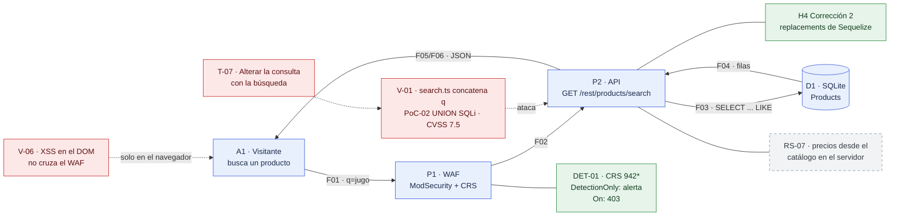
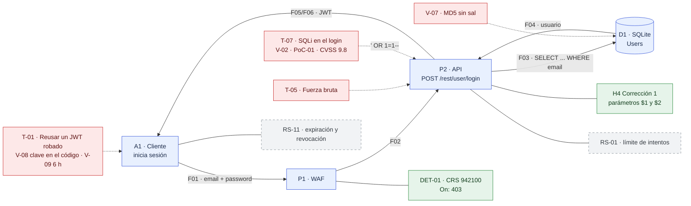
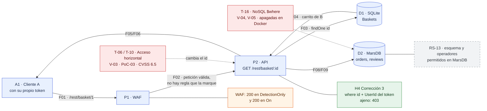
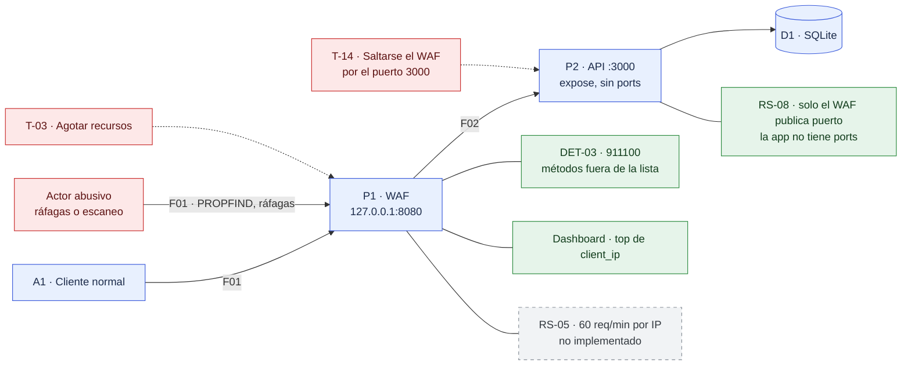
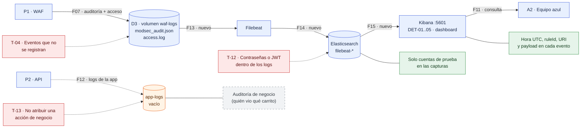

# Diagramas por objetivo de negocio

El [DFD general](02-PASTA-3-DFD.md) muestra todo el sistema. Aquí se corta ese mismo diagrama por cada objetivo de [PASTA I](01-PASTA-1-2.md): qué parte del sistema toca, qué amenaza lo pone en riesgo, qué debilidad del código la hace posible y qué control la detiene. Los IDs son los mismos de todo el proyecto: flujos `F`, amenazas `T` ([STRIDE](03-PASTA-4-STRIDE.md)), debilidades `V` ([etapa V](03b-PASTA-5-Vulnerabilidades.md)), PoC del [Hito 2](../hito-2/README.md), reglas `DET` del [Hito 3](../hito-3/README.md) y correcciones del [Hito 4](../hito-4/README.md).

Los diagramas están en Mermaid (GitHub los dibuja); las mismas imágenes en PNG, para la presentación, están en [`diagramas-objetivos/`](diagramas-objetivos/).

Cómo leerlos:

- Azul: actores y componentes del DFD (con el mismo ID).
- Rojo: amenaza o debilidad.
- Verde: control que ya funciona y tiene evidencia.
- Gris punteado: control propuesto que todavía no se implementó.

| Objetivo | Flujos del DFD | Amenazas | Debilidad / PoC | Control principal |
|---|---|---|---|---|
| ON-01 Catálogo confiable | F01, F02, F03/F04, F05/F06 | T-07, T-09, T-08 | V-01 → PoC-02 · V-06 | WAF DET-01 + consulta parametrizada (H4 Corrección 2) |
| ON-02 Cuentas protegidas | F01, F02, F03/F04, F06 (JWT) | T-05, T-07, T-01 | V-02 → PoC-01 · V-07, V-08, V-09 | WAF DET-01 + login parametrizado (H4 Corrección 1) |
| ON-03 Carritos y pedidos separados | F01, F02, F03/F04, F08/F09 | T-06, T-10, T-16 | V-03 → PoC-03 · V-04, V-05 | Verificación de dueño en el código (H4 Corrección 3). El WAF no lo ve |
| ON-04 Disponibilidad | F01, F02 | T-03, T-14 | Escaneo de métodos · ráfagas | Solo el WAF publica puerto; DET-03; límite de tasa pendiente |
| ON-05 Trazabilidad | F07, F12 y los flujos nuevos del SIEM (F13–F15) | T-04, T-12, T-13 | IDOR invisible para el WAF | Filebeat → Elastic → Kibana, DET-01..05 y dashboard |

## ON-01 · Consultas confiables al catálogo

El catálogo es público, pero lo que devuelve la búsqueda tiene que salir de la tabla `Products` y de nada más. La búsqueda es la entrada más expuesta de la tienda: el parámetro `q` llega directo a SQLite.

Cómo lo pensamos: el WAF es la primera barrera, pero no es la corrección. Con el WAF en `DetectionOnly` el UNION de PoC-02 sigue devolviendo correos y hashes; la consulta parametrizada del H4 hace que el mismo payload se busque como texto y no devuelva nada. V-06 queda fuera de los dos controles porque el payload vive en el fragmento de la URL.

## ON-02 · Proteger las cuentas

El activo son las credenciales y el JWT que la API entrega al iniciar sesión. Si el login se puede saltar, todo lo demás (carritos, direcciones, pedidos) queda expuesto.

Cómo lo pensamos: PoC-01 es el hallazgo más grave del proyecto (entra como administrador sin contraseña), por eso va primero en el H4. Las debilidades de sesión (V-08, V-09) y el hash MD5 (V-07) quedan como riesgo aceptado del laboratorio; están documentadas, no corregidas.

## ON-03 · Mantener separados carritos y pedidos

Cada cliente solo debe ver su carrito. Aquí el WAF no ayuda: la petición del ataque es idéntica a la legítima, solo cambia el número en la ruta.

Cómo lo pensamos: este objetivo es el argumento de por qué el WAF no basta. La autorización por recurso solo se puede hacer en la aplicación, que es la que sabe de quién es cada carrito. La corrección cubre `GET /rest/basket/:id`; el checkout (`POST /rest/basket/:id/checkout`) tiene el mismo patrón y queda anotado como riesgo pendiente.

## ON-04 · Mantener la disponibilidad

Que la tienda siga respondiendo a clientes normales mientras alguien la escanea o le manda ráfagas. Es el objetivo con menos controles implementados, y se dice tal cual.

Cómo lo pensamos: el CRS no limita la tasa de peticiones. Lo que sí tenemos es contención (nadie llega a la app sin pasar por el WAF) y visibilidad (el panel de IPs del dashboard muestra quién manda más tráfico). El límite de tasa de RS-05 queda propuesto.

## ON-05 · Poder reconstruir eventos sospechosos

En el H1 el DFD terminaba en los logs de Docker (D3). Con el H3 se agregó el SIEM, así que este diagrama trae tres flujos nuevos que no estaban en el DFD general.

Cómo lo pensamos: todo lo que pasa por el WAF se puede reconstruir en Kibana con hora, regla y payload. Lo que el WAF no ve (el IDOR de ON-03) tampoco queda en el SIEM, porque la app no escribe logs a `app-logs/`. Esa es la brecha de trazabilidad que queda abierta.
